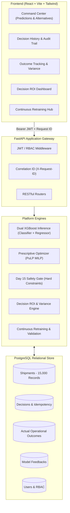

# SupplyPrescript — AI-Powered Supply Chain Decision Intelligence Platform

[]()
[-brightgreen.svg)]()
[-brightgreen.svg)]()
[]()
[]()
[]()
[]()
[]()

SupplyPrescript is an enterprise-grade prescriptive supply chain intelligence platform. It bridges predictive machine learning, mathematical prescriptive optimization, operational write-back, closed-loop financial verification, and continuous model learning:

$$\text{Shipment} \longrightarrow \text{ML Delay Prediction} \longrightarrow \text{Optimization} \longrightarrow \text{Safety Gate} \longrightarrow \text{Decision Write-Back} \longrightarrow \text{Actual Outcome} \longrightarrow \text{ROI Engine} \longrightarrow \text{Feedback Loop} \longrightarrow \text{Retraining \& Safe Rollback}$$

---

## 🚀 1-Click Automated Demonstration

Run the automated 12-stage closed-loop demonstration runner directly from your terminal:

```bash
# Standalone in-process execution (FastAPI + PostgreSQL Local)
PYTHONPATH=backend:optimization python3 scripts/demo_lifecycle.py
```

Or run against a live running backend server:
```bash
PYTHONPATH=backend:optimization python3 scripts/demo_lifecycle.py --api-url http://localhost:8000
```

---

## 🏛 System Architecture



---

## 📚 Portfolio Documentation

Comprehensive architectural, operational, and engineering reports are available in [`docs/`](docs/):

| Document | Description |
| :--- | :--- |
| **[Final Integration Report](docs/final_integration_report.md)** | Complete 16-point Day 25 integration audit, lifecycle trace, test summaries, and release assessment. |
| **[System Architecture](docs/architecture.md)** | Component architecture, data flow diagrams, ER schemas, and technology stack. |
| **[Demonstration Runbook](docs/demo_runbook.md)** | Step-by-step setup, database migrations, CLI demo runner, UI walkthrough, and test verification. |
| **[API Specification Overview](docs/api_overview.md)** | Comprehensive REST API contract reference, schemas, error envelopes, and RBAC matrix. |
| **[Known Limitations](docs/known_limitations.md)** | Documented architectural boundaries, model assumptions, and enterprise scaling prerequisites. |
| **[Security Review](docs/security_review.md)** | Threat model, authentication hardening, RBAC matrix, and mitigation evidence. |
| **[Production Readiness Audit](docs/production_readiness_audit.md)** | Day 24 hardening audit, anti-spoofing guarantees, and failure mode analysis. |
| **[Decision ROI Engine](docs/decision_roi_engine.md)** | Mathematical formulation of financial variance, money saved, and decision success scoring. |
| **[Automatic Retraining](docs/automatic_retraining.md)** | Drift monitoring, candidate validation rules, and emergency rollback mechanics. |

---

## 🛠 Technology Stack

- **Frontend:** React 18, Vite 5, Tailwind CSS 3, Recharts, Lucide React, Vitest.
- **Backend:** FastAPI, Python 3.10+, Pydantic v2, SQLAlchemy 2, Alembic, PyJWT, Passlib, Pytest.
- **Data & ML:** PostgreSQL 15, XGBoost 2.0, Scikit-learn, Pandas, NumPy.
- **Prescriptive Optimization:** PuLP MILP Solver (COIN-OR CBC).

---

## ⚡ Quickstart

### 1. Database Setup
```bash
# Start local PostgreSQL instance via Docker Compose
docker compose up -d postgres

# Apply database migrations to head
alembic upgrade head
```

### 2. Start Backend API
```bash
# Install Python dependencies and run Uvicorn
pip install -r backend/requirements.txt
PYTHONPATH=backend:optimization uvicorn app.main:app --host 0.0.0.0 --port 8000 --reload
```
- Interactive API Documentation: [http://localhost:8000/docs](http://localhost:8000/docs)
- Health Check: [http://localhost:8000/api/health](http://localhost:8000/api/health)

### 3. Start Frontend UI
```bash
cd frontend
npm install
npm run dev
```
- Web Application: [http://localhost:5173](http://localhost:5173)

---

## 🧪 Automated Testing

### Backend Test Suite (303 Tests)
```bash
PYTHONPATH=backend:optimization pytest tests/ -v
```
All 303 tests pass across 24 test suites covering authentication, shipments, predictions, decisions, outcomes, ROI calculations, model retraining, and end-to-end regression.

### Frontend Test Suite (64 Tests)
```bash
cd frontend
npm test -- --run
```
All 64 unit and integration tests pass across 17 component test suites.

### Production Build
```bash
cd frontend
npm run build
```
Production build bundles cleanly in ~1.5 seconds.

---

## 👥 Demo User Credentials

| Role | Username | Password | Operational Scope |
| :--- | :--- | :--- | :--- |
| **Operator** | `operator` | `Operator123!` | Ingestion, predictions, decision execution, outcome recording. |
| **Analyst** | `analyst` | `Analyst123!` | Read analytics, ROI dashboard, generate feedback snapshots. |
| **Admin** | `admin` | `Admin123!` | Retraining execution, candidate model promotion, emergency rollback. |
