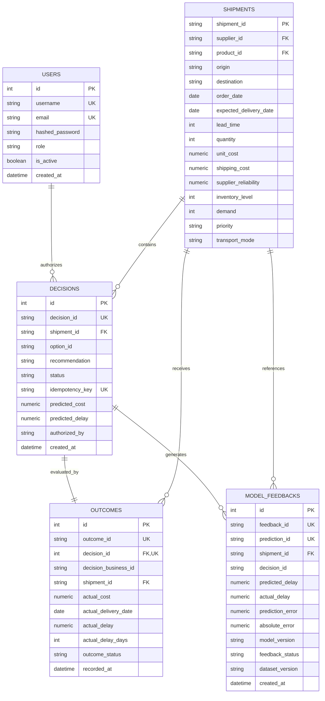

# SupplyPrescript — System Architecture & Design

**Phase:** Phase 8 — Production Polish  
**System:** SupplyPrescript — AI-Powered Supply Chain Decision Intelligence Platform  
**Version:** 1.0.0  

---

## 1. Architectural Overview

SupplyPrescript is architected as a modular, closed-loop decision intelligence platform that integrates predictive machine learning with mathematical prescriptive optimization, operational write-back, financial return analytics, and continuous model feedback.

```mermaid
flowchart TD
    subgraph UI ["Frontend (React + Vite + Tailwind)"]
        CC[Command Center]
        DH[Decision History]
        OT[Outcome Tracking]
        ROI[Decision ROI Dashboard]
        MLD[Feedback & Retraining Hub]
    end

    subgraph API ["FastAPI Application Gateway"]
        Auth[JWT / RBAC Middleware]
        ReqID[Correlation ID Middleware]
        Routes[API Routers]
    end

    subgraph Core ["Platform Engines"]
        MLPred["Predictive Engine (Dual XGBoost)"]
        OptSolver["Optimization Engine (PuLP MILP)"]
        SafetyGate["Safety Gate (Hard Constraints)"]
        ROIEngine["Decision ROI Engine"]
        RetrainService["Continuous Retraining Service"]
    end

    subgraph Storage ["PostgreSQL Relational Store"]
        DB_Shipments[(Shipments)]
        DB_Decisions[(Decisions)]
        DB_Outcomes[(Outcomes)]
        DB_Feedback[(Model Feedbacks)]
        DB_Users[(Users & RBAC)]
    end

    subgraph ML_Registry ["Model Governance"]
        RegActive["Active Registry (v1.0)"]
        RegCandidates["Candidate Validation Pool"]
    end

    %% User interactions
    UI -->|Bearer JWT + Request ID| API
    API --> Core

    %% Predictive flow
    Routes -->|Inference Query| MLPred
    MLPred -->|Active Models| RegActive
    MLPred -->|Predicted Delay & Risk| OptSolver

    %% Optimization & Gate
    OptSolver --> SafetyGate
    SafetyGate -->|Filtered Alternatives| Routes

    %% Operational Write-back
    Routes -->|Execute Decision| DB_Decisions
    DB_Decisions --> DB_Shipments

    %% Outcome Tracking & ROI
    Routes -->|Record Actuals| DB_Outcomes
    DB_Outcomes --> ROIEngine
    DB_Decisions --> ROIEngine
    ROIEngine --> Routes

    %% Continuous Learning Closed Loop
    DB_Outcomes -->|Feedback Ingestion| DB_Feedback
    DB_Feedback --> RetrainService
    RetrainService -->|Train Candidates| RegCandidates
    RegCandidates -->|Validate (>=3% MAE)| RegActive
```

---

## 2. Core Subsystems

### 2.1 API & Security Layer
- **Framework:** FastAPI with Python 3.10+ async support and Pydantic v2 data models.
- **Authentication & RBAC:**
  - Standard JSON Web Tokens (JWT) signed with HMAC-SHA256.
  - Three distinct operational roles: `OPERATOR`, `ANALYST`, `ADMIN`.
- **Observability:**
  - Automated correlation ID middleware injecting `X-Request-ID` into every request/response.
  - Standardized error response envelope masking sensitive stack traces in non-debug environments:
    ```json
    {
      "error": {
        "code": "ERROR_CODE",
        "message": "Human-readable explanation.",
        "request_id": "req-..."
      }
    }
    ```
- **Idempotency Protection:**
  - Write operations (`POST /api/decisions`) accept a unique `idempotency_key`.
  - Exact replays return cached HTTP 200 responses.
  - Conflicting payloads with identical keys are rejected with HTTP 409 Conflict.

### 2.2 Machine Learning Inference Pipeline
- **Dual XGBoost Pipeline:**
  - **Classifier:** Predicts binary delay probability ($P(\text{Delayed} > 0)$) and maps to risk categories (`Low`, `Medium`, `High`, `Critical`).
  - **Regressor:** Predicts estimated delay duration in days.
- **Model Registry:**
  - Stored under `models/versions/<version>/` containing serialized pipelines, encoders, and evaluation metadata.
  - Active model dynamically managed via `config/model_registry.json`.

### 2.3 Prescriptive Optimization Engine
- **Solver:** Mixed-Integer Linear Programming (MILP) solved using CBC through PuLP.
- **Alternative Formulations:**
  1. **Air Freight Expedited:** Maximum delay reduction; premium transit cost.
  2. **Secondary Regional Supplier:** Moderate delay reduction; balanced procurement premium.
  3. **Accept Delay / Status Quo:** Zero mitigation investment; incurs risk of inventory stockout.
- **Day 15 Safety Gate:**
  - Hard constraint audit verifying warehouse inventory, forecasted demand, lead time, and safety stock compliance.
  - Infeasible options are rejected and cannot be executed by operators.

### 2.4 Decision Write-Back & Actual Outcome Ingestion
- Decisions are committed directly to PostgreSQL with foreign key links to `shipments`.
- The operational outcome subsystem captures:
  - `actual_cost` (verified against billing/invoicing)
  - `actual_delivery_date` (verified against carrier delivery receipts)
  - `actual_delay` and `actual_delay_days`
  - Delivery completion status (`DELIVERED`, `IN_TRANSIT`, `RETURNED`)

### 2.5 Decision ROI Engine
- Evaluates operational outcomes against both **predictions** and **baselines**:
  - **Cost Variance:** $\text{Actual Cost} - \text{Predicted Cost}$
  - **Delay Variance:** $\text{Actual Delay} - \text{Predicted Delay}$
  - **Verified Money Saved:** $\text{Baseline Cost} - \text{Actual Cost}$
  - **Net ROI:** $\frac{\text{Net Benefit}}{\text{Investment Cost}} \times 100$
  - **Decision Success Score:** Normalized multi-criteria composite score ($0.0 \text{ to } 1.0$) evaluating cost adherence, delay reduction, and stockout prevention.

### 2.6 Feedback Pipeline & Continuous Retraining
- Completed outcomes are converted into versioned feedback observations.
- Prediction error is tracked across model versions:
  - $\text{Signed Error} = \text{Actual Delay} - \text{Predicted Delay}$
  - $\text{Absolute Error} = |\text{Actual Delay} - \text{Predicted Delay}|$
- Retraining triggers when MAE degrades by $\ge 15\%$ or $\ge 0.25$ days.
- Candidates must pass independent validation ($\ge 3\%$ MAE improvement) before promotion.
- Emergency rollback restores previous stable model in $< 50\text{ ms}$.

---

## 3. Database Schema & Entity Relationships



---

## 4. Technology Stack

| Layer | Component | Technology | Version | Purpose |
| :--- | :--- | :--- | :--- | :--- |
| **Frontend** | Framework | React | 18.2 | Single-page application UI |
| | Tooling | Vite | 5.4 | Fast build tool & dev server |
| | Styling | Tailwind CSS | 3.4 | Responsive utility-first design |
| | Charts | Recharts | 2.12 | Interactive ROI and analytics charts |
| | Icons | Lucide React | 0.344 | Clean modern iconography |
| | Testing | Vitest + RTL | 2.1 | Component and integration unit tests |
| **Backend** | API Server | FastAPI | 0.110+ | Asynchronous RESTful microservice |
| | Runtime | Python | 3.10+ | Core application runtime |
| | Validation | Pydantic | 2.6+ | Request/response data validation |
| | ORM | SQLAlchemy | 2.0+ | Database persistence & querying |
| | Migrations | Alembic | 1.13+ | Schema revision management |
| | Auth | PyJWT + Passlib | 2.8+ | JWT token issuance and hashing |
| | Testing | Pytest + TestClient | 8.0+ | Automated backend test framework |
| **Data & ML**| Database | PostgreSQL | 15+ | Transactional operational store |
| | Optimization | PuLP + CBC | 2.8+ | Mixed-Integer Linear Programming |
| | ML Framework | XGBoost + Scikit-learn| 2.0+ / 1.4+ | Delay classification and regression |
| | Data Science | Pandas + NumPy | 2.2+ / 1.26+ | Feature engineering and analytics |
