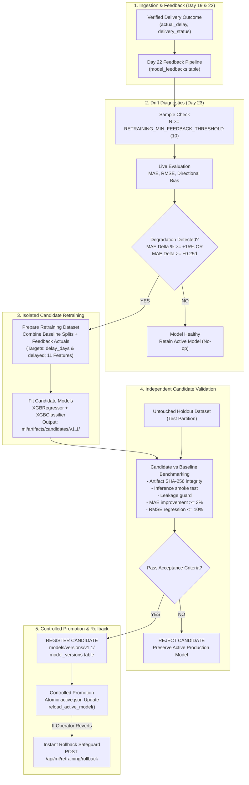

# SupplyPrescript — Monitored Automatic Retraining Pipeline (Day 23)

**Phase:** 7 — Continuous Learning  
**Date:** October 26, 2026  
**Status:** Complete & Production Ready  
**Promotion Policy:** Controlled Promotion (Human-in-the-Loop Sign-Off / Reversible)

---

## 1. Executive Summary & Purpose

The **Monitored Automatic Retraining Pipeline** completes the second half of Phase 7 (Continuous Learning) in SupplyPrescript. While Day 22 established ground-truth tracking, signed error calculations, and versioned feedback dataset exports, Day 23 operationalizes this data into a closed-loop model lifecycle:

1. **Drift & Performance Monitoring:** Evaluates incoming verified outcomes against documented baseline performance.
2. **Degradation Detection:** Confirms statistical drift before initiating resource-intensive training.
3. **Isolated Candidate Retraining:** Trains candidate XGBoost regression and classification models in isolated storage directories without touching the active production artifacts.
4. **Independent Benchmark Validation:** Validates candidates on identical chronological holdout data against the active baseline model.
5. **Enforced Acceptance Criteria:** Enforces non-negotiable performance thresholds (MAE improvement, RMSE non-regression, artifact checksum integrity, smoke tests).
6. **Controlled Atomic Promotion & Rollback:** Maintains atomic registry updates via `active.json` and PostgreSQL, ensuring zero prediction downtime and instant one-click rollback.

---

## 2. End-to-End Retraining Workflow



---

## 3. Trigger Conditions & Performance Degradation Detection

### 3.1 Monitoring Trigger
Trigger evaluation occurs in two ways:
1. **Event-Driven:** Whenever `POST /api/feedback/generate` executes or new verified delivery actuals are ingested, `trigger_feedback_monitoring_cycle` evaluates model health.
2. **On-Demand / Operator Trigger:** Via `POST /api/ml/retraining/run`.

### 3.2 Concurrency & Cooldown Guards
- **Cooldown:** `RETRAINING_COOLDOWN_MINUTES = 60`. Retraining runs within 60 minutes of a recent job are deferred.
- **Concurrency:** `RETRAINING_MAX_CONCURRENT_JOBS = 1`. Prevents resource exhaustion.
- **Bypass:** `force=True` parameter allows authorized manual overrides during scheduled testing.

### 3.3 Degradation Rules & Mathematical Thresholds
Monitored against the recorded baseline for the active model version (e.g. `models/versions/v1.0/metrics.json`):

| Metric | Target / Formula | Degradation Threshold | Meaning |
|---|---|---|---|
| **Relative MAE Drift** | $\Delta\%_{\text{MAE}} = \frac{\text{live\_mae} - \text{base\_mae}}{\text{base\_mae}} \times 100$ | $\ge +15.0\%$ | Model prediction error magnitude has worsened by 15% or more |
| **Absolute MAE Drift** | $\Delta_{\text{MAE}} = \text{live\_mae} - \text{base\_mae}$ | $\ge +0.25\text{ days}$ | Average delivery delay forecast is off by an additional quarter-day |
| **Severe RMSE Drift** | $\Delta\%_{\text{RMSE}} = \frac{\text{live\_rmse} - \text{base\_rmse}}{\text{base\_rmse}} \times 100$ | $\ge +25.0\%$ | Large outlier forecast errors have escalated significantly |
| **Directional Bias Shift** | $\text{Mean Signed Error} = \text{mean}(\text{actual} - \text{predicted})$ | $|\text{bias}| \ge 1.5\text{ days}$ | Model exhibits systematic under- or over-estimation |

> [!NOTE]
> **Sample Size Invariant:** Degradation rules are **only** evaluated when verified feedback observations equal or exceed `RETRAINING_MIN_FEEDBACK_THRESHOLD` (provisional default: 10). If sample count is below this threshold, the pipeline returns `INSUFFICIENT_DATA` and defers retraining.

---

## 4. Training Data Preparation & Anti-Leakage Safeguards

### 4.1 Target Definitions
Retraining strictly preserves Day 6 target definitions:
- **Regression:** `delay_days` (actual physical delay in days $\ge 0.0$).
- **Classification:** `delayed` ($1$ if $\text{actual\_delay} > 0.0$, else $0$).

> [!CAUTION]
> Candidates are **never** trained on `prediction_error`. `prediction_error` is an evaluation metric, not the ground-truth prediction target.

### 4.2 Approved Features
Candidate models are trained strictly on the 11 approved order-time features:
- **Numerical (8):** `supplier_reliability`, `historical_avg_delay`, `lead_time`, `inventory_level`, `demand`, `quantity`, `shipping_cost`, `distance`.
- **Categorical (3):** `transport_mode`, `season`, `priority`.

### 4.3 Anti-Leakage Invariants
- Preprocessing transformers (`preprocessor = build_preprocessor()`) are fitted **exclusively on the training partition**.
- Every candidate dataset passes `check_feature_matrix_for_leakage`. Post-order outcome columns (`actual_delivery_date`, `delivery_status`, `is_delayed`, `delay_days`, `prediction_error`) are strictly blacklisted from feature matrix $X$.
- Retraining datasets are fingerprinted via SHA-256 for deterministic traceability.

---

## 5. Candidate Validation & Acceptance Criteria

Before any candidate can be registered or promoted, `validate_candidate_model` benchmarks the candidate against the active baseline model on an **identical untouched chronological holdout**:

| Validation Check | Acceptance Requirement | Failure Consequence |
|---|---|---|
| **Artifact Integrity** | All 5 artifacts exist; SHA-256 matches recorded checksums | Immediate Rejection |
| **Schema Compatibility** | Exactly 11 approved features present; preprocessor valid | Immediate Rejection |
| **Smoke Test Inference** | Probabilities $\in [0.0, 1.0]$; delays $\ge 0.0$; no NaNs or Infs | Immediate Rejection |
| **Data Leakage Check** | Zero target or outcome leakage in feature matrix $X$ | Immediate Rejection |
| **Sample Size Check** | Holdout evaluation sample size $\ge \text{min\_eval\_samples}$ | Immediate Rejection |
| **MAE Improvement** | Candidate MAE must meet or beat baseline MAE by $\ge 3.0\%$ | Rejection |
| **RMSE Regression Limit** | Candidate RMSE must not regress by more than $+10.0\%$ | Rejection |

---

## 6. Model Versioning & Safe Promotion

### 6.1 Version Allocation Progression
Versions advance minor increments:
$$\text{v1.0} \longrightarrow \text{v1.1} \longrightarrow \text{v1.2}$$
(or $\text{v1.0.0} \longrightarrow \text{v1.1.0}$).

### 6.2 Atomic Promotion Mechanism
1. Candidate artifacts are verified via `verify_model_artifacts`.
2. Pointer update in `models/versions/active.json` is atomic using temporary file writes and `os.replace`.
3. Canonical single-file compatibility model `models/xgboost_delay_model.pkl` is synchronized.
4. Database table `model_versions` is updated: previous version deactivated, candidate activated.
5. In-memory prediction cache is refreshed via `ml.predict.reload_active_model()`. Zero prediction server restarts required.

### 6.3 Emergency Rollback
If operational drift is observed in a newly deployed model:
- Endpoint: `POST /api/ml/retraining/rollback` with `{ "target_version": "v1.0" }`.
- Restores prior validated model immediately without deleting candidate audit logs or validation reports.

---

## 7. Retraining Job Lifecycle & Database Model

Persisted in PostgreSQL table `retraining_jobs` (Alembic revision `a794b281f3e1`):

```text
       [QUEUED]
          |
          v
      [RUNNING] ---> [FAILED] (on training exception)
          |
          v
     [EVALUATING]
       /        \
(Rejected)    (Accepted)
   /              \
[REJECTED]     [REGISTERED]
                    |
           (Controlled Promotion)
                    |
                    v
                [PROMOTED]
```

### Database Schema (`retraining_jobs`):
- `id`: Integer primary key
- `job_id`: String(64) unique index (`RETRAIN_YYYYMMDD_XXXXXX`)
- `trigger_reason`: String(255)
- `triggered_by`: String(100)
- `parent_model_version`: String(32)
- `candidate_model_version`: String(32) nullable
- `dataset_version`: String(64) nullable
- `status`: String(32) indexed (`QUEUED`, `RUNNING`, `EVALUATING`, `REGISTERED`, `PROMOTED`, `REJECTED`, `FAILED`, `INSUFFICIENT_DATA`, `CANCELLED`)
- `started_at`, `completed_at`: DateTime timezone-aware
- `baseline_metrics`, `candidate_metrics`, `acceptance_result`: JSONB
- `failure_reason`: Text nullable

---

## 8. REST API Reference

| Method | Endpoint | Description |
|---|---|---|
| `GET` | `/api/ml/retraining/monitor` | Returns performance drift diagnostics, live MAE vs baseline, and degradation status |
| `POST` | `/api/ml/retraining/run` | Requests retraining run; checks data adequacy and degradation unless `force=True` |
| `GET` | `/api/ml/retraining/jobs` | Lists historical and running retraining jobs with status filter and pagination |
| `GET` | `/api/ml/retraining/jobs/{job_id}` | Detailed job execution view with candidate metrics and validation report |
| `POST` | `/api/ml/retraining/jobs/{job_id}/promote` | Promotes an accepted `REGISTERED` candidate model to active production |
| `POST` | `/api/ml/retraining/rollback` | Rolls back active production model to a verified prior registered version |

---

## 9. Frontend Retraining Monitor

Integrated into the **Model Feedback & Retraining Matrix** (`/feedback` and `/retraining`):
- **Tab 1 — Prediction Errors & Feedback (Day 22):** Summary cards, drift diagnostics, error observation table, dataset manifests.
- **Tab 2 — Automated Retraining & Candidate Monitor (Day 23):**
  - **RetrainingStatusCards:** Live status (`Healthy`, `Degraded`, `Insufficient Data`), Active model version (`v1.0`), Live MAE vs Baseline MAE, Promotion policy.
  - **RetrainingJobTable:** Audit trail of all retraining runs, status badges, trigger rationales, candidate versions, Details modal trigger.
  - **RetrainingJobDetailsModal:** Full execution inspection, candidate vs baseline metric deltas, and "Promote to Production" action button.
  - **Emergency Production Rollback Safeguard:** One-click rollback button to restore `v1.0`.

---

## 10. Security, Configuration & Known Limitations

### Configuration (`backend/app/core/config.py`)
```bash
RETRAINING_MIN_FEEDBACK_THRESHOLD=10        # Minimum verified actuals before evaluation
RETRAINING_MIN_TRAIN_SAMPLES=50             # Minimum training samples
RETRAINING_MIN_VAL_SAMPLES=15               # Minimum validation samples
RETRAINING_DEGRADATION_MAE_THRESHOLD_PCT=15.0 # 15% MAE degradation triggers training
RETRAINING_DEGRADATION_MAE_ABSOLUTE_DAYS=0.25 # 0.25 days MAE degradation triggers training
RETRAINING_MIN_IMPROVEMENT_PCT=3.0          # Candidate must improve MAE by >= 3%
RETRAINING_MAX_SECONDARY_REGRESSION_PCT=10.0 # RMSE regression capped at 10%
RETRAINING_COOLDOWN_MINUTES=60              # Cooldown period between runs
RETRAINING_MAX_CONCURRENT_JOBS=1            # Concurrency limit
RETRAINING_AUTO_PROMOTION_ENABLED=False     # Human sign-off required by default
```

### Known Limitations
1. **Live Verified Sample Count:** The live database currently contains 3 verified `ELIGIBLE` actual delivery outcomes. Because this is below the minimum threshold of 10, production degradation detection truthfully reports `INSUFFICIENT_DATA` and defers production model modification.
2. **Synchronous Job Execution:** Jobs are currently executed synchronously in-process via FastAPI. For massive enterprise workloads ($>100,000$ shipments), a Celery/Redis or ARQ background task queue is recommended.
