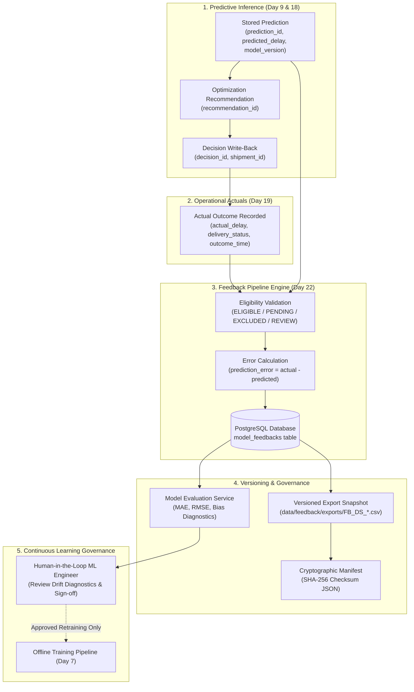

# SupplyPrescript — Model Feedback Pipeline Architecture (Day 22)

**Phase:** 7 — Continuous Learning  
**Date:** October 25, 2026  
**Status:** Implemented & Verified (Production Ready)  
**Safety Policy:** Diagnostic & Continuous Feedback (Zero Automated Production Retraining)

---

## 1. Executive Summary & Objective

The **Model Feedback Pipeline** completes Phase 7 of SupplyPrescript by establishing a closed-loop learning infrastructure that links operational reality back to predictive models. It continuously compares stored ML delay predictions generated at recommendation time against ground-truth delivery outcomes recorded upon shipment arrival.

### Core Objectives
1. **Traceable Ground Truth:** Automatically link original predictions with operational actuals across the lifecycle:
   $$\text{Prediction} \longrightarrow \text{Recommendation} \longrightarrow \text{Decision} \longrightarrow \text{Actual Outcome} \longrightarrow \text{Feedback Observation}$$
2. **Explicit Sign Conventions:** Standardize error calculations:
   $$\text{prediction\_error} = \text{actual\_delay} - \text{predicted\_delay}$$
   Positive values denote that the actual delay was greater than predicted (the shipment arrived late; the model underestimated delay). Negative values denote that the actual delay was less than predicted (the shipment arrived early; the model overestimated delay).
3. **Rigorous Eligibility Filtering:** Segregate verified ground truth from in-transit deliveries. Never coerce pending deliveries to zero error.
4. **Cryptographic Versioned Datasets:** Generate deterministic, immutable feedback dataset snapshots accompanied by SHA-256 JSON manifests for reproducible, audited offline model retraining.
5. **Model Evaluation & Drift Diagnostics:** Calculate Mean Absolute Error (MAE), Root Mean Squared Error (RMSE), Directional Bias (MSE), and Median Absolute Error without automated model promotion.

---

## 2. End-to-End Pipeline Architecture



---

## 3. Mathematical Calculations & Sign Conventions

### 3.1 Delay Prediction Error

$$\text{prediction\_error} = \text{actual\_delay} - \text{predicted\_delay}$$

- **Positive Error ($> 0$):** Underprediction. Actual delay exceeded forecast; the shipment arrived later than the model anticipated.
- **Negative Error ($< 0$):** Overprediction. Actual delay was lower than forecast; the shipment arrived earlier than the model anticipated.
- **Zero Error ($= 0$):** Exact match between forecast and observed delivery.

### 3.2 Absolute Error

$$\text{absolute\_error} = |\text{prediction\_error}| = |\text{actual\_delay} - \text{predicted\_delay}|$$

### 3.3 Continuous Evaluation Aggregate Metrics

For a set of $N$ eligible feedback observations:

- **Mean Absolute Error (MAE):**
  $$\text{MAE} = \frac{1}{N} \sum_{i=1}^{N} |\text{actual\_delay}_i - \text{predicted\_delay}_i|$$
- **Root Mean Squared Error (RMSE):**
  $$\text{RMSE} = \sqrt{\frac{1}{N} \sum_{i=1}^{N} (\text{actual\_delay}_i - \text{predicted\_delay}_i)^2}$$
- **Mean Signed Error (Directional Bias):**
  $$\text{MSE} = \frac{1}{N} \sum_{i=1}^{N} (\text{actual\_delay}_i - \text{predicted\_delay}_i)$$
  A positive bias indicates systematic model optimism (underestimating delays), while a negative bias indicates systematic conservatism (overestimating delays).
- **Median Absolute Error:**
  $$\text{Median AE} = \text{median}\left(\{|\text{actual\_delay}_i - \text{predicted\_delay}_i|\}_{i=1}^N\right)$$

---

## 4. Feedback Eligibility Validation Rules

Every prediction-outcome candidate pair is audited through `validate_feedback_eligibility`:

| Eligibility Status | Description | Prediction Error | Evaluated in Metrics? |
|---|---|---|---|
| `ELIGIBLE` | Completed delivery, non-negative delay, verified outcome | Computed (`actual - predicted`) | **Yes** |
| `PENDING_OUTCOME` | Delivery in transit or pending actual delivery record | `None` (Never imputed as zero) | **No** |
| `EXCLUDED` | Cancelled shipment, negative delay, corrupt timestamps, delay $>90$ days | `None` (With audit rationale) | **No** |
| `UNDER_REVIEW` | Disputed delivery actuals flagged by operator | `None` or withheld | **No** |

### Integrity Invariants:
1. **Never Assume Zero:** Pending shipments must never be treated as having an error of $0.0$.
2. **Negative Delay Prohibited:** Physical delays cannot be negative; any record with `actual_delay < 0` is classified as `EXCLUDED`.
3. **Plausibility Bounds:** Any observed delay exceeding 90 days is classified as an outlier anomaly (`EXCLUDED`) pending review.

---

## 5. PostgreSQL Schema & Database Migration

### 5.1 SQLAlchemy ORM Model: `Feedback`
Defined in [`backend/app/models/feedback.py`](file:///Users/sujal/Desktop/SupplyPrescript/backend/app/models/feedback.py):

```python
class Feedback(Base):
    __tablename__ = "model_feedbacks"

    id = Column(Integer, primary_key=True, autoincrement=True)
    feedback_id = Column(String(64), unique=True, nullable=False, index=True)
    prediction_id = Column(String(64), unique=True, nullable=False, index=True)
    shipment_id = Column(String(64), nullable=True, index=True)
    decision_id = Column(String(64), nullable=True, index=True)
    predicted_delay = Column(Float, nullable=False)
    actual_delay = Column(Float, nullable=True)
    prediction_error = Column(Float, nullable=True)
    absolute_error = Column(Float, nullable=True)
    prediction_timestamp = Column(DateTime(timezone=True), nullable=False)
    outcome_timestamp = Column(DateTime(timezone=True), nullable=True)
    model_version = Column(String(32), nullable=False, index=True)
    feedback_status = Column(String(32), nullable=False, index=True)
    exclusion_reason = Column(Text, nullable=True)
    dataset_version = Column(String(64), nullable=True, index=True)
    notes = Column(Text, nullable=True)
    created_at = Column(DateTime(timezone=True), default=datetime.utcnow, nullable=False)
    updated_at = Column(DateTime(timezone=True), default=datetime.utcnow, onupdate=datetime.utcnow, nullable=True)
```

### 5.2 Alembic Migration
- Migration ID: `e3678692959f_create_model_feedbacks_table.py`
- Revision Chain: `6c26ac4fad37` (Day 20 ROI) $\longrightarrow$ `e3678692959f` (Day 22 Feedback)
- Database Indexes: `ix_model_feedbacks_feedback_id`, `ix_model_feedbacks_prediction_id`, `ix_model_feedbacks_shipment_id`, `ix_model_feedbacks_model_version`, `ix_model_feedbacks_feedback_status`, `ix_model_feedbacks_dataset_version`.

---

## 6. Versioned Feedback Datasets & Cryptographic Manifests

Feedback datasets generated for offline model retraining are persisted with cryptographic audit trails:
- **Manifest Location:** `data/feedback/manifests/{dataset_version}.json`
- **CSV Data Export:** `data/feedback/exports/{dataset_version}.csv`

### Manifest Schema Example:
```json
{
  "dataset_version": "FB_DS_20261025_001",
  "created_at": "2026-10-25T08:30:00Z",
  "schema_version": "1.0",
  "row_count": 24,
  "eligible_count": 18,
  "excluded_count": 2,
  "pending_count": 4,
  "model_versions": ["v1.0.0"],
  "source_predictions": ["PRED-101", "PRED-102", "PRED-103"],
  "eligibility_rules": [
    "actual_delay must be non-negative (>= 0.0)",
    "shipment delivery status must be DELIVERED/COMPLETED",
    "delivery delay must not exceed 90.0 days"
  ],
  "metrics_summary": {
    "mae": 0.85,
    "rmse": 1.12,
    "mean_signed_error": 0.35,
    "evaluated_count": 18
  },
  "checksum": "e3b0c44298fc1c149afbf4c8996fb92427ae41e4649b934ca495991b7852b855"
}
```

---

## 7. REST API Endpoints

| Method | Endpoint | Description |
|---|---|---|
| `POST` | `/api/feedback/generate` | Scans predictions & outcomes, populates feedback records, and exports versioned dataset |
| `GET` | `/api/feedback` | Paginated listing with filtering by `shipment_id`, `model_version`, `feedback_status`, `dataset_version` |
| `GET` | `/api/feedback/{feedback_id}` | Detailed observation lookup |
| `POST` | `/api/feedback/evaluate` | Computes MAE, RMSE, directional bias, and sample size diagnostics for a model version |
| `GET` | `/api/feedback/datasets` | Retrieves list of versioned dataset manifests with checksums |

---

## 8. Frontend Interface

The Model Feedback interface is accessible via the navigation item **Model Feedback** (`/feedback`):
1. **Summary Cards (`FeedbackSummaryCards.jsx`):** Displays Total Predictions, Eligible Records, Pending Actuals, Excluded Records, Delay MAE, Directional Bias, Active Model Version, and Dataset Snapshot.
2. **Model Evaluation Panel (`ModelEvaluationPanel.jsx`):** Allows selecting model version and minimum sample threshold, computing MAE, RMSE, directional bias, preliminary warnings, and human-readable interpretation.
3. **Prediction Error Table (`PredictionErrorTable.jsx`):** Paginated, sortable table displaying Prediction ID, Shipment ID, Model Version, Predicted Delay, Actual Delay, Error (with sign color styling: rose if $>0$, emerald if $<0$), Absolute Error, and Eligibility Status.
4. **Dataset Manifests History (`FeedbackDatasetHistory.jsx`):** Interactive cards displaying exported dataset snapshots with copyable SHA-256 checksums and one-click filtering.
5. **Eligibility Badges (`FeedbackStatusBadge.jsx`):** Color-coded status badges for `ELIGIBLE` (emerald), `PENDING_OUTCOME` (amber), `EXCLUDED` (rose), and `UNDER_REVIEW` (violet).

---

## 9. Continuous Learning Safety Policy

> [!CAUTION]
> **Zero Automated Retraining Policy:** Automated model retraining, automatic promotion to production, and unreviewed parameter updates are strictly prohibited in the feedback pipeline.
> 
> **Rationale:** Direct automated retraining without human oversight risks catastrophic distribution collapse, self-reinforcing feedback loops, and data poisoning. The feedback pipeline provides auditable ground-truth datasets and drift metrics for human ML engineers to review and validate offline.
