# SupplyPrescript — Day 19: Actual Outcome Tracking & Closed-Loop Analytics

**Phase:** 6 — Closed-Loop Analytics  
**Document:** Operational Outcome Tracking, Schema Evolution & Comparison Engine  
**Version:** 1.0.0  
**Date:** October 22, 2026  
**Status:** Verified & Production Ready  

---

## 1. System Overview & Closed-Loop Architecture

SupplyPrescript bridges machine learning predictions, prescriptive optimization, and real-world operational execution.

While **Day 18** established the immutable write-back ledger of authorized decisions, **Day 19** implements the **Closed-Loop Feedback System**:
1. When a decision is fulfilled in the real world, the actual cost, actual delivery date, fulfilling supplier, and delivered quantity are recorded in PostgreSQL.
2. The comparison engine automatically reconciles stored prescriptive predictions with verified actuals to compute cost variance, delay variance, milestone delivery variance, and quantity variance.
3. Strict operational governance guarantees:
   - Predictions recorded at decision time remain completely immutable.
   - Predictions are never silently re-run with newer models to fit actual outcomes.
   - Each decision has at most one final operational outcome enforced via a unique constraint.
   - Missing actuals or undelivered shipments are never fabricated or coerced to zero.
   - Data sources (manual operational entry vs ERP vendor invoices vs carrier webhooks) are tracked transparently.

```mermaid
flowchart TD
    subgraph Day18 [Day 18 Write-Back Architecture]
        Dec[Decision Stored in PostgreSQL] -->|Immutable Predictions| Snap[Snapshot: predicted_cost, predicted_delay]
    end

    subgraph Day19 [Day 19 Closed-Loop Analytics]
        RealWorld[Operational Execution / Freight Delivery] -->|Inbound Invoice / Carrier POD| Input[POST /api/decisions/:id/outcome]
        Input --> Val[Validate Cost, Dates, Supplier, Quantity]
        Val --> UQCheck{Existing Outcome?}
        UQCheck -->|Yes| Conflict[409 Conflict: One Final Outcome]
        UQCheck -->|No| CalcDelay[Calculate Actual Delay from Baseline Date]
        CalcDelay --> Insert[INSERT into outcomes Table]
        Insert --> Commit[(PostgreSQL Ledger)]
        Commit --> Comp[Run Outcome Comparison Engine]
        Comp --> Response[201 Created: Outcome + Variances]
    end

    subgraph CommandCenter [Operational Dashboard]
        UI[Command Center / Decision Audit] -->|GET /api/decisions/:id/outcome| CompView[Predicted vs Actual Comparison]
        UI -->|Record Actuals| Modal[Outcome Entry Modal]
    end
```



---

## 2. Database Schema & Data Model

The operational `outcomes` table resides in PostgreSQL (`localhost:5432/supplyprescript`). It was updated from the baseline schema via Alembic migration `6c26ac4fad37_add_outcome_tracking_fields.py`.

### Table Definition: `outcomes`

| Column Name | SQL Data Type | Nullable | Default / Constraints | Description |
| :--- | :--- | :--- | :--- | :--- |
| `id` | `INTEGER` | `NO` | Primary Key, Auto-increment | Internal surrogate primary key |
| `outcome_id` | `VARCHAR(50)` | `NO` | `UNIQUE NOT NULL` | Business outcome identifier (`OUT-YYYYMMDD-XXXX`) |
| `decision_id` | `INTEGER` | `NO` | `UNIQUE`, FK `decisions.id` (RESTRICT) | Links directly to decision primary key (1-to-1) |
| `decision_business_id` | `VARCHAR(64)` | `YES` | Indexed `ix_outcomes_decision_business_id` | Business identifier (`DEC-YYYYMMDD-XXXX`) |
| `shipment_id` | `VARCHAR(50)` | `YES` | FK `fk_outcomes_shipment_id` | References `shipments.shipment_id` ON DELETE SET NULL |
| `actual_cost` | `NUMERIC(12, 2)`| `NO` | Check `actual_cost >= 0` | Authoritative actual cost incurred |
| `currency` | `VARCHAR(10)` | `YES` | Default `'USD'` | Currency denomination |
| `actual_delivery_date` | `DATE` | `YES` | Indexed | Actual delivery date (null if in-transit) |
| `actual_delay` | `NUMERIC(6, 2)` | `YES` | Check `actual_delay >= 0` | Calculated delay in calendar days relative to baseline |
| `actual_delay_days` | `INTEGER` | `NO` | Default `0` | Rounded calendar days delay |
| `baseline_delivery_date` | `DATE` | `YES` | — | Agreed baseline delivery date from shipment |
| `actual_supplier` | `VARCHAR(100)` | `YES` | — | Fulfilling supplier / carrier reference |
| `actual_quantity` | `NUMERIC(10, 2)`| `YES` | Check `actual_quantity > 0` | Actual quantity delivered / received |
| `outcome_status` | `VARCHAR(50)` | `NO` | Check `ck_outcomes_status` | Lifecycle status (`DELIVERED`, `AWAITING_DELIVERY`, `RECORDED`, `CANCELLED`, `DISPUTED`) |
| `source` | `VARCHAR(50)` | `YES` | Default `'manual_entry'` | Data origin (`manual_entry`, `erp_invoice`, `carrier_webhook`) |
| `notes` | `TEXT` | `YES` | — | Operational rationale for cost/schedule variances |
| `recorded_by` | `VARCHAR(100)` | `YES` | Indexed `ix_outcomes_recorded_by` | Actor identifier |
| `recorded_at` | `TIMESTAMPTZ` | `NO` | Default `now()` | Timestamp when outcome was recorded |
| `updated_at` | `TIMESTAMPTZ` | `YES` | Default `now()` | Timestamp of last modification |

### Constraints & Indexes
1. **Primary Key**: `pk_outcomes` on `(id)`.
2. **Business Key**: `uq_outcomes_outcome_id` (`UNIQUE`) on `(outcome_id)`.
3. **One-to-One Decision Constraint**: `uq_outcomes_decision_id` (`UNIQUE`) on `(decision_id)` enforcing strictly one outcome record per decision.
4. **Foreign Key**: `fk_outcomes_shipment_id` on `outcomes(shipment_id)` referencing `shipments(shipment_id)` ON DELETE SET NULL.
5. **Foreign Key**: `fk_outcomes_decision_id` on `outcomes(decision_id)` referencing `decisions(id)`.
6. **Check Constraints**:
   - `ck_outcomes_actual_cost`: `actual_cost >= 0`
   - `ck_outcomes_actual_delay`: `actual_delay IS NULL OR actual_delay >= 0`
   - `ck_outcomes_actual_quantity`: `actual_quantity IS NULL OR actual_quantity > 0`
   - `ck_outcomes_status`: `outcome_status IN ('Success', 'Partial Success', 'Failure', 'Pending', 'RECORDED', 'DELIVERED', 'AWAITING_DELIVERY', 'CANCELLED', 'DISPUTED')`

---

## 3. Definition of Actual Delay

Actual delay measures calendar-day slippage relative to the contractually agreed delivery deadline:

$$\text{actual\_delay} = \max\left(0, \text{actual\_delivery\_date} - \text{baseline\_delivery\_date}\right)$$

### Rules & Edge-Case Governance
1. **Baseline Source**: Sourced authoritatively from `shipments.expected_delivery_date` (or explicitly submitted baseline date).
2. **On-Time / Early Deliveries**: If a shipment arrives on or before the baseline date, $\text{actual\_delay} = 0.0$ calendar days (early arrival is recorded as 0 delay, not negative delay).
3. **Undelivered / In-Transit Shipments**: If `actual_delivery_date` is `null`, `actual_delay` remains strictly `null`. It is **never** calculated using current timestamp or fabricated to 0.
4. **Date Milestones**: Dates are normalized to calendar date values without time-of-day offsets.

---

## 4. Comparison Engine & Sign Conventions

The comparison service resides in [`backend/app/services/outcome_comparison.py`](file:///Users/sujal/Desktop/SupplyPrescript/backend/app/services/outcome_comparison.py).

### Metric Formulas
| Metric | Formula | Sign Convention |
| :--- | :--- | :--- |
| **Cost Variance** | $\text{actual\_cost} - \text{predicted\_cost}$ | Positive ($+$) = Over budget / Cost increase<br>Negative ($-$) = Cost savings |
| **Cost Variance %** | $\frac{\text{actual\_cost} - \text{predicted\_cost}}{\text{predicted\_cost}} \times 100$ | Positive ($+$) = % Over budget<br>Undefined if $\text{predicted\_cost} = 0$ |
| **Delay Variance** | $\text{actual\_delay} - \text{predicted\_delay}$ | Positive ($+$) = Later than predicted (slippage)<br>Negative ($-$) = Earlier than predicted |
| **Milestone Date Diff** | $(\text{actual\_delivery\_date} - \text{predicted\_delivery\_date}).\text{days}$ | Positive ($+$) = Calendar days late<br>Negative ($-$) = Calendar days early |
| **Quantity Variance** | $\text{actual\_quantity} - \text{planned\_quantity}$ | Negative ($-$) = Shortage / Partial delivery<br>Zero ($0$) = Exact quantity delivered |
| **Supplier Match** | $\text{actual\_supplier} == \text{planned\_supplier}$ | `true` = Matched planned vendor<br>`false` = Substituted vendor |

### Calculation Safety Guarantees
- **Zero Division**: If `predicted_cost == 0`, `cost_variance_percentage` is returned as `null` with an explanatory note rather than raising a runtime error.
- **Currency Mismatch**: If `actual.currency != predicted.currency`, `cost_variance` is returned as `null` with a currency mismatch warning.
- **Missing Data Handling**: Missing values result in `null` metric outputs and a detailed breakdown in `notes`. Missing actuals are **never** treated as zero.
- **Completeness Classification**:
  - `COMPLETE`: All four variances (cost, delay, milestone date, quantity) are fully computed.
  - `PARTIAL`: Some metrics are available (e.g. cost is known, but delivery date is pending).
  - `NO_OUTCOME`: Decision has been authorized, but no actual outcome record has been entered yet.

---

## 5. API Endpoints Specification

### 5.1. `POST /api/decisions/{decision_id}/outcome`
Records an actual operational outcome for an authorized decision.

- **Request Body (`RecordOutcomeRequest`)**:
  ```json
  {
    "actual_cost": 16200.00,
    "currency": "USD",
    "actual_delivery_date": "2026-10-25",
    "actual_delay": null,
    "actual_supplier": "SUPPLIER_EXPEDITED",
    "actual_quantity": 500,
    "outcome_status": "DELIVERED",
    "source": "manual_entry",
    "notes": "Emergency air freight fuel surcharge applied due to weekend customs clearance."
  }
  ```
- **Response (`201 Created` - `OutcomeComparisonResponse`)**:
  ```json
  {
    "decision_id": "DEC-20261021-0001",
    "shipment_id": "SHIP000005",
    "predicted": {
      "predicted_cost": 15000.0,
      "predicted_delay": 1.0,
      "predicted_delivery_date": "2026-10-24",
      "planned_quantity": 500.0,
      "planned_supplier": "SUP000001",
      "currency": "USD"
    },
    "actual": {
      "outcome_id": "OUT-20261022-A1B2C3",
      "actual_cost": 16200.0,
      "actual_delay": 2.0,
      "actual_delivery_date": "2026-10-25",
      "actual_quantity": 500.0,
      "actual_supplier": "SUPPLIER_EXPEDITED",
      "currency": "USD",
      "outcome_status": "DELIVERED",
      "source": "manual_entry",
      "recorded_at": "2026-10-22T10:00:00Z"
    },
    "variance": {
      "cost_variance": 1200.0,
      "cost_variance_percentage": 8.0,
      "delay_variance": 1.0,
      "delivery_date_variance_days": 1,
      "quantity_variance": 0.0,
      "supplier_matched": false
    },
    "data_completeness": "COMPLETE",
    "notes": [],
    "outcome": {
      "outcome_id": "OUT-20261022-A1B2C3",
      "decision_id": "DEC-20261021-0001",
      "shipment_id": "SHIP000005",
      "actual_cost": 16200.0,
      "currency": "USD",
      "actual_delivery_date": "2026-10-25",
      "actual_delay": 2.0,
      "baseline_delivery_date": "2026-10-23",
      "actual_supplier": "SUPPLIER_EXPEDITED",
      "actual_quantity": 500.0,
      "outcome_status": "DELIVERED",
      "source": "manual_entry",
      "notes": "Emergency air freight fuel surcharge applied due to weekend customs clearance.",
      "recorded_by": "usr_ops_manager",
      "recorded_at": "2026-10-22T10:00:00Z",
      "updated_at": "2026-10-22T10:00:00Z"
    }
  }
  ```
- **Error Codes**:
  - `400 Bad Request`: Empty decision identifier.
  - `404 Not Found`: Decision record does not exist.
  - `409 Conflict`: Outcome already exists for this decision (one-to-one constraint).
  - `422 Unprocessable Entity`: Negative cost or invalid payload data.

### 5.2. `GET /api/decisions/{decision_id}/outcome`
Retrieves the recorded outcome and closed-loop comparison.
- **Status `200 OK`**: Returns `OutcomeComparisonResponse`.
- **Status `404 Not Found`**: Returns `404` if decision has no recorded outcome.

### 5.3. `GET /api/outcomes`
Lists recorded outcomes with pagination and filtering.
- **Query Parameters**:
  - `shipment_id` (`str`, optional)
  - `supplier` (`str`, optional)
  - `outcome_status` (`str`, optional)
  - `start_date` / `end_date` (`date`, optional)
  - `limit` (`int`, default 20, max 100)
  - `offset` (`int`, default 0)
- **Status `200 OK`**: Returns `OutcomeListResponse` with `{ total, limit, offset, items }`.

---

## 6. Frontend Components & User Experience

Components are located in [`frontend/src/components/outcomes/`](file:///Users/sujal/Desktop/SupplyPrescript/frontend/src/components/outcomes/):

1. **`PredictedActualComparison.jsx`**: Side-by-side table and metric cards comparing Predicted vs Actual vs Variance across Cost, Delivery Date, Schedule Delay, Supplier, and Quantity.
2. **`OutcomeVarianceCards.jsx`**: Summary metric tiles with clear directional indicators:
   - Green for cost savings ($-$) or early arrival ($-$).
   - Amber for cost overruns ($+$) or delay slippage ($+$).
   - Slate for on-target ($0$) or pending metrics.
3. **`OutcomeEntryModal.jsx`**: Interactive form allowing supply-chain operations to record actual invoices, delivery dates, fulfilling suppliers, and notes with client-side validation.
4. **`OutcomeStatusBadge.jsx`**: Semantic lifecycle badges for `DELIVERED`, `AWAITING_DELIVERY`, `RECORDED`, `CANCELLED`, and `DISPUTED`.
5. **`DecisionDetailModal.jsx`**: Dual-tab interface supporting seamless switching between the immutable write-back record and the closed-loop actuals comparison.
6. **`DecisionHistory.jsx`**: Added an **Outcome** action button to each decision audit row, enabling one-click inspection or outcome entry.

---

## 7. Data Quality, Verification & Auditability

1. **Immutable Predictions**: Stored prediction values (`predicted_cost`, `predicted_delay`) are never overwritten when outcomes are submitted.
2. **Manual vs Integration Sourced Actuals**: The `source` attribute explicitly flags whether actuals originate from `manual_entry`, `erp_invoice`, `carrier_webhook`, or `warehouse_scan`.
3. **One Outcome Per Decision**: Enforced via PostgreSQL database unique constraint `uq_outcomes_decision_id`.
4. **Audit Trail**: Every outcome captures `recorded_by`, `recorded_at`, and `updated_at`.

---

## 8. Automated Test Verification Summary

- **Database Unit Tests ([`tests/database/test_outcomes.py`](file:///Users/sujal/Desktop/SupplyPrescript/tests/database/test_outcomes.py))**: **5/5 Passed**
  - Real SQL `INSERT` and commit verification.
  - Unique constraint `uq_outcomes_decision_id` duplicate rejection.
  - Check constraint rejection for negative costs and negative delays.
  - Precision and scale verification on `NUMERIC(12, 2)`.
- **Backend API Integration Tests ([`tests/api/test_outcomes.py`](file:///Users/sujal/Desktop/SupplyPrescript/tests/api/test_outcomes.py))**: **10/10 Passed**
  - POST /api/decisions/:id/outcome creation and variance accuracy.
  - 409 Conflict rejection for duplicate outcomes.
  - 404 Not Found for nonexistent decisions.
  - Early delivery delay calculation ($\text{actual\_delay} = 0$).
  - Undelivered shipment delay safety (`null`, not fabricated).
  - Currency mismatch handling.
  - GET /api/decisions/:id/outcome comparison retrieval.
  - GET /api/outcomes listing, filtering, and pagination.
- **Frontend Unit Tests ([`frontend/src/__tests__/OutcomeTracking.test.jsx`](file:///Users/sujal/Desktop/SupplyPrescript/frontend/src/__tests__/OutcomeTracking.test.jsx))**: **5/5 Passed**
  - Side-by-side comparison rendering.
  - Directional variance cards styling.
  - Form validation and `recordOutcome` service dispatch.
  - Negative cost rejection.
  - Tab navigation in `DecisionDetailModal`.
- **Full Backend Pytest Suite**: **223 passed, 0 failed** in 5.60s.
- **Full Frontend Vitest Suite**: **35 passed, 0 failed** across 13 test files in 3.55s.
- **Vite Production Build**: Production build succeeded in 6.92s with zero errors.
