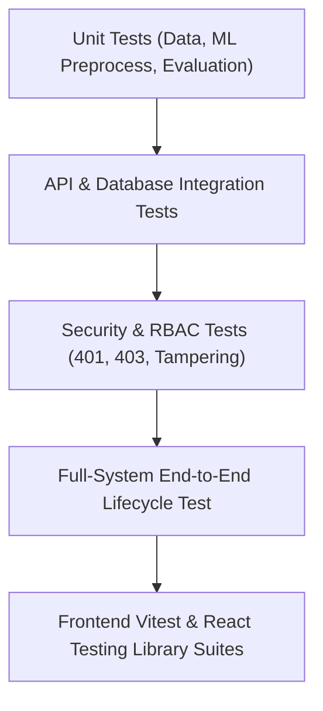

# SupplyPrescript — System Testing Strategy & Quality Assurance (Day 24)

**Document Version:** 1.0.0  
**Phase:** 8 — Production Polish  
**Date:** October 27, 2026  
**Auditor Roles:** Senior QA Engineer, Full-Stack Engineer, ML Platform Engineer  

---

## 1. Testing Architecture & Scope

SupplyPrescript employs a multi-tiered testing strategy spanning unit, database persistence, ML model evaluation, optimization safety gates, security RBAC verification, frontend component/page tests, and end-to-end full system lifecycle integration tests.



---

## 2. Test Suites Summary & Execution Commands

### A. Backend Pytest Suites

```bash
# Execute full backend test suite with project paths
PYTHONPATH=backend:optimization pytest tests/ -v
```

**Results (Day 24 Final):**
- Total Collected: **302 items**
- Passed: **302 passed**
- Failed: **0**
- Duration: **~10.89s**

**Coverage Breakdown:**
1. `tests/api/test_analytics_dashboard_api.py` (8 tests) — Portfolio ROI, trend analysis, filters.
2. `tests/api/test_dashboard.py` (1 test) — Operational metrics dashboard endpoint.
3. `tests/api/test_decisions.py` (18 tests) — Decision execution, Day 15 hard constraints, idempotency 200 replay & 409 conflict.
4. `tests/api/test_feedback_api.py` (8 tests) — Feedback observation generation, eligibility rules, versioning.
5. `tests/api/test_inventory.py` (5 tests) — Stock levels, SKU queries, stockout risk.
6. `tests/api/test_optimization_alternatives.py` (5 tests) — Alternative generation for individual shipments.
7. `tests/api/test_outcomes.py` (10 tests) — Outcome recording, delay calculations, currency mismatch checks.
8. `tests/api/test_predictions.py` (18 tests) — XGBoost inference, leakage rejection, feature lookup.
9. `tests/api/test_retraining_api.py` (7 tests) — Retraining endpoints, drift monitoring, rollback.
10. `tests/api/test_roi_api.py` (5 tests) — Decision ROI engine calculations.
11. `tests/api/test_shipments.py` (12 tests) — Pagination, sorting, multi-criteria filtering.
12. `tests/api/test_suppliers.py` (6 tests) — Supplier reliability metrics and profiles.
13. `tests/backend/test_api.py` (4 tests) — Health checks and API connectivity.
14. `tests/backend/test_decision_roi_engine.py` (16 tests) — Financial variance formulas and decision success classifications.
15. `tests/backend/test_prediction_feedback_engine.py` (14 tests) — Prediction error formulas and eligibility filtering.
16. `tests/data/test_data_pipeline.py` (40 tests) — Schema integrity, cleaning, and transformation.
17. `tests/database/test_outcomes.py` (5 tests) — PostgreSQL constraints and triggers.
18. `tests/database/test_relationships.py` (9 tests) — Foreign key constraints and cascading behavior.
19. `tests/database/test_schema.py` (10 tests) — Database column types and indices.
20. `tests/database/test_write_back.py` (6 tests) — Atomic transactional commits and rollback safety.
21. `tests/e2e/test_full_system_lifecycle.py` (1 test) — Complete 17-step lifecycle integration test.
22. `tests/ml/test_data_leakage.py` (6 tests) — Strict prevention of target leakage.
23. `tests/ml/test_evaluate.py` (14 tests) — MAE, RMSE, R2, ROC-AUC, PR-AUC evaluation routines.
24. `tests/ml/test_model_loading.py` (5 tests) — Preprocessor and model joblib deserialization.
25. `tests/ml/test_model_persistence.py` (8 tests) — Model artifact serialization and hash checks.
26. `tests/ml/test_model_registry.py` (7 tests) — Version metadata tracking and active version pointer.
27. `tests/ml/test_model_retraining.py` (9 tests) — Monitored retraining pipeline and candidate validation.
28. `tests/ml/test_model_versioning.py` (4 tests) — Model version migrations.
29. `tests/ml/test_predict.py` (7 tests) — Inference mathematical edge cases.
30. `tests/ml/test_prediction_service.py` (9 tests) — End-to-end inference service with DB hydration.
31. `tests/ml/test_preprocess.py` (7 tests) — Standard scaler and one-hot encoder pipelines.
32. `tests/ml/test_train.py` (5 tests) — Classifier and regressor training routines.
33. `tests/optimization/test_optimization_engine.py` (1 test) — PuLP solver and hard constraint enforcement.
34. `tests/security/test_security_and_hardening.py` (11 tests) — Authentication, RBAC, anti-spoofing, error envelopes.
35. `tests/test_dataset.py` (1 test) — Raw dataset loading and validation.

---

### B. Frontend Vitest Suites

```bash
cd frontend && npm test -- --run
```

**Results (Day 24 Final):**
- Test Files: **17 passed (17)**
- Total Tests: **64 passed (64)**
- Duration: **~4.7s**

**Coverage Breakdown:**
1. `src/__tests__/CommandCenter.test.jsx` (7 tests) — Prescriptive action center, filters, alternative execution.
2. `src/__tests__/Dashboard.test.jsx` (2 tests) — KPI summaries and charts.
3. `src/__tests__/DecisionHistory.test.jsx` (4 tests) — Audited execution table, status badges, details modal.
4. `src/__tests__/DecisionROI.test.jsx` (8 tests) — Decision ROI page, financial variance cards, success badges.
5. `src/__tests__/DecisionROIDashboard.test.jsx` (10 tests) — Strategy aggregations, accuracy charts, filters.
6. `src/__tests__/ExecuteDecisionModal.test.jsx` (5 tests) — Safety constraints, confirmation modal, submit protection.
7. `src/__tests__/FeedbackPipeline.test.jsx` (6 tests) — Feedback observation tables, error calculations, evaluation panel.
8. `src/__tests__/Inventory.test.jsx` (1 test) — Inventory tables and stockout indicators.
9. `src/__tests__/Navigation.test.jsx` (1 test) — Sidebar links and brand logo.
10. `src/__tests__/OutcomeTracking.test.jsx` (5 tests) — Outcome recording modal, predicted-vs-actual comparison.
11. `src/__tests__/PredictionForm.test.jsx` (1 test) — Input validation and submission.
12. `src/__tests__/PredictionResult.test.jsx` (2 tests) — Delay risk card rendering.
13. `src/__tests__/Predictions.test.jsx` (1 test) — Predictions page and history table.
14. `src/__tests__/RecommendedAlternatives.test.jsx` (4 tests) — Multi-criteria alternatives rendering.
15. `src/__tests__/RetrainingPipeline.test.jsx` (5 tests) — Drift monitoring, candidate validation report, promotion.
16. `src/__tests__/Shipments.test.jsx` (1 test) — Shipment listings, filtering, sorting.
17. `src/__tests__/Suppliers.test.jsx` (1 test) — Supplier table and reliability metrics.

---

### C. Frontend Production Build

```bash
cd frontend && npm run build
```

**Results:**
- Clean build in **7.25s** with zero errors.
- Bundle sizes: `index.html` (0.56 kB), `index.css` (62.02 kB), `index.js` (1,152 kB).
