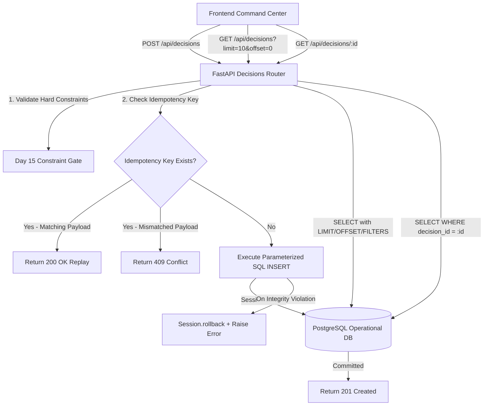

# SupplyPrescript — Day 18: Operational Write-Back Architecture

**Phase:** 5 — Operational Web Application  
**Document:** Operational Write-Back Architecture & Persistence Ledger  
**Version:** 1.0.0 (PostgreSQL Operational Ledger)  
**Date:** October 21, 2026  
**Status:** Verified & Production Ready  

---

## 1. System Overview & Architecture

SupplyPrescript bridges machine learning predictions, operations research prescriptive optimization, and operational decision governance.

In Day 17, the frontend Command Center introduced the **EXECUTE DECISION** confirmation flow and established the governance safety boundary. In **Day 18**, SupplyPrescript establishes the **Write-Back Architecture**:
1. When an authorized supply-chain decision is executed, the backend executes an actual, parameterized `INSERT` transaction into the primary PostgreSQL `decisions` operational table.
2. The transaction is explicitly committed to the relational database before a `201 Created` response is returned to the client.
3. If an identical decision is submitted with a matching idempotency key, the endpoint detects the replay, verifies payload consistency, and returns `200 OK` without creating duplicate records or mutating the state.
4. Comprehensive query APIs (`GET /api/decisions` with pagination/filtering and `GET /api/decisions/{decision_id}`) provide full auditable access to historical decisions.
5. In accordance with operational safety policies, external carrier bookings and financial disbursements remain strictly `external_action_status: "NOT_EXECUTED"`.



---

## 2. PostgreSQL Schema & Data Model

The operational `decisions` table resides in PostgreSQL (`localhost:5432/supplyprescript`). It was extended from the Day 17 schema via Alembic migration `21e279b9475a_add_write_back_fields.py`.

### Table Definition: `decisions`

| Column Name | SQL Data Type | Nullable | Default / Constraints | Description |
| :--- | :--- | :--- | :--- | :--- |
| `id` | `INTEGER` | `NO` | Primary Key, Auto-increment | Internal surrogate primary key |
| `decision_id` | `VARCHAR(64)` | `NO` | `UNIQUE NOT NULL` | Business identifier (`DEC-YYYYMMDD-XXXX`) |
| `shipment_id` | `VARCHAR(50)` | `YES` | Foreign Key `fk_decisions_shipment_id` | References `shipments(shipment_id)` ON DELETE SET NULL |
| `user_id` | `VARCHAR(100)` | `YES` | Indexed `ix_decisions_user_id` | Executing user identifier |
| `recommendation_id`| `INTEGER` | `YES` | Foreign Key `recommendations(id)` | Associated recommendation run (if present) |
| `decision` | `VARCHAR(255)`| `NO` | `NOT NULL` | Human-readable decision summary |
| `strategy` | `VARCHAR(50)` | `NO` | `NOT NULL` | Strategy code (`AIR_FREIGHT`, `EXPEDITE_SUPPLIER`, etc.) |
| `option_id` | `VARCHAR(10)` | `YES` | — | Alternative option code (`A`, `B`, `C`) |
| `decision_reason` | `TEXT` | `YES` | — | Prescriptive justification |
| `approved_by` | `VARCHAR(100)`| `YES` | — | Authorizing actor / role |
| `notes` | `TEXT` | `YES` | — | User-submitted audit notes |
| `status` | `VARCHAR(50)` | `NO` | `CHECK (status IN ('RECORDED', 'Pending', 'Approved', 'Rejected', 'Executed'))` | Operational lifecycle status (`RECORDED`) |
| `estimated_total_cost`| `NUMERIC(12, 2)`| `YES`| Check `cost >= 0` | Authoritative estimated total cost |
| `predicted_cost` | `NUMERIC(12, 2)`| `YES` | Check `cost >= 0` | Day 18 explicit predicted cost contract |
| `estimated_delivery_days`| `NUMERIC(6, 2)`| `YES`| Check `days >= 0` | Total transit delivery duration in days |
| `predicted_delay` | `NUMERIC(6, 2)`| `YES` | Check `delay >= 0` | Estimated shipment delay in days |
| `currency` | `VARCHAR(10)` | `YES` | `'USD'` | Transaction currency code |
| `decision_time` | `TIMESTAMPTZ` | `NO` | `NOT NULL`, Indexed | Timezone-aware recorded timestamp |
| `created_at` | `TIMESTAMPTZ` | `NO` | `DEFAULT now()` | Record creation timestamp |
| `updated_at` | `TIMESTAMPTZ` | `NO` | `DEFAULT now()` | Record modification timestamp |
| `idempotency_key` | `VARCHAR(128)`| `YES` | `UNIQUE` (`ix_decisions_idempotency_key`) | Safe replay token |
| `external_action_status`| `VARCHAR(50)`| `YES`| `'NOT_EXECUTED'` | Explicit safety boundary marker |

### Indexes & Integrity Constraints
1. **Primary Key**: `pk_decisions` on `(id)`.
2. **Business Key**: `uq_decisions_decision_id` (`UNIQUE`) on `(decision_id)`.
3. **Idempotency Key**: `ix_decisions_idempotency_key` (`UNIQUE`) on `(idempotency_key)`.
4. **Foreign Key**: `fk_decisions_shipment_id` on `decisions(shipment_id)` referencing `shipments(shipment_id)` ON DELETE SET NULL.
5. **Foreign Key**: `fk_decisions_recommendation_id` on `decisions(recommendation_id)` referencing `recommendations(id)`.
6. **Query Optimization Indexes**:
   - `ix_decisions_user_id` on `decisions(user_id)`.
   - `ix_decisions_decision_time` on `decisions(decision_time)`.
   - `ix_decisions_shipment_id` on `decisions(shipment_id)`.
   - `ix_decisions_status` on `decisions(status)`.

---

## 3. Alembic Migration & Reversibility

The migration file is located at `database/migrations/versions/21e279b9475a_add_write_back_fields.py`.

### Migration Operations
```python
def upgrade():
    # 1. Add write-back contract columns
    op.add_column('decisions', sa.Column('user_id', sa.String(length=100), nullable=True))
    op.add_column('decisions', sa.Column('predicted_cost', sa.Numeric(precision=12, scale=2), nullable=True))
    op.add_column('decisions', sa.Column('predicted_delay', sa.Numeric(precision=6, scale=2), nullable=True))
    op.add_column('decisions', sa.Column('decision_time', sa.DateTime(timezone=True), nullable=True))
    
    # 2. Backfill decision_time from created_at for existing rows
    op.execute("UPDATE decisions SET decision_time = created_at WHERE decision_time IS NULL")
    op.alter_column('decisions', 'decision_time', nullable=False)
    
    # 3. Create indexes
    op.create_index('ix_decisions_user_id', 'decisions', ['user_id'])
    op.create_index('ix_decisions_decision_time', 'decisions', ['decision_time'])
    
    # 4. Add foreign key constraint
    op.create_foreign_key(
        'fk_decisions_shipment_id',
        'decisions', 'shipments',
        ['shipment_id'], ['shipment_id'],
        ondelete='SET NULL'
    )
```

### Verified Downgrade & Upgrade Cycle
The migration was applied and verified against the live PostgreSQL database:
- `alembic downgrade -1`: Cleanly removed foreign key `fk_decisions_shipment_id`, dropped indexes `ix_decisions_user_id` and `ix_decisions_decision_time`, and dropped columns `user_id`, `predicted_cost`, `predicted_delay`, and `decision_time`.
- `alembic upgrade head`: Cleanly re-applied all columns, constraints, and indexes.

---

## 4. API Endpoints Specification

### 4.1. `POST /api/decisions`
Executes write-back of an authorized prescriptive decision into PostgreSQL.

- **Request Body (`ExecuteDecisionRequest`)**:
  ```json
  {
    "shipment_id": "SHIP000005",
    "option_id": "A",
    "recommendation": "AIR_FREIGHT",
    "user_id": "usr_ops_lead",
    "optimization_run_id": "OPT-RUN-20261021-001",
    "idempotency_key": "idem-uuid-9999",
    "notes": "Authorization for priority expedited transit.",
    "approved_by": "Operations Lead"
  }
  ```
- **Response (`201 Created`)**:
  ```json
  {
    "decision_id": "DEC-20261021-0001",
    "shipment_id": "SHIP000005",
    "user_id": "usr_ops_lead",
    "recommendation": "AIR_FREIGHT",
    "strategy": "AIR_FREIGHT",
    "option_id": "A",
    "predicted_cost": 41583.04,
    "predicted_delay": 0.5,
    "decision_time": "2026-10-21T14:32:00.123456+00:00",
    "status": "RECORDED",
    "external_action_status": "NOT_EXECUTED",
    "idempotency_key": "idem-uuid-9999",
    "notes": "Authorization for priority expedited transit.",
    "message": "Decision successfully authorized and committed to operational PostgreSQL ledger."
  }
  ```
- **Response (`200 OK`)**: Returned on idempotent replay of identical payload.
- **Response (`409 Conflict`)**: Returned when an existing `idempotency_key` is reused with mismatched parameters (`shipment_id` or `option_id`).
- **Response (`422 Unprocessable Entity`)**: Returned when hard constraints are violated or invalid options are supplied.

### 4.2. `GET /api/decisions`
Lists historical decisions with database-level pagination and filtering.

- **Query Parameters**:
  - `shipment_id` (`str`, optional): Filter by target shipment ID.
  - `user_id` (`str`, optional): Filter by executing user ID.
  - `status` (`str`, optional): Filter by operational status (e.g. `RECORDED`).
  - `start_time` (`datetime`, optional): Filter decisions recorded at or after timestamp.
  - `end_time` (`datetime`, optional): Filter decisions recorded at or before timestamp.
  - `limit` (`int`, default 20, max 100): Page limit.
  - `offset` (`int`, default 0, min 0): Page offset.
- **Response (`200 OK`)**:
  ```json
  {
    "total": 42,
    "limit": 10,
    "offset": 0,
    "items": [ ... ],
    "decisions": [ ... ]
  }
  ```

### 4.3. `GET /api/decisions/{decision_id}`
Retrieves a single decision record by business `decision_id` (e.g., `DEC-20261021-0001`) or primary key integer.

- **Response (`200 OK`)**: Full `DecisionResponse` object.
- **Response (`404 Not Found`)**: Returned if no record exists matching the provided identifier.

---

## 5. Idempotency & Concurrency Governance

Network retries and multiple user submissions are managed via the `idempotency_key` attribute:
1. When `idempotency_key` is provided in `POST /api/decisions`, the server queries the database for an existing row matching `decisions.idempotency_key == key`.
2. **Identical Replay**: If found and the `shipment_id` and `strategy`/`option_id` match the existing record, the server immediately returns the existing record with HTTP `200 OK` and message `"Decision previously recorded (idempotent replay). No duplicate action executed."`.
3. **Mismatched Replay Conflict**: If found but the payload targets a different shipment or alternative, the server rejects the request with HTTP `409 Conflict`: `"Idempotency key collision with mismatched shipment or strategy parameters."`.
4. **Database-Level Guarantee**: A unique index `ix_decisions_idempotency_key` enforces consistency at the database engine level, preventing race conditions.

---

## 6. Definition of Predicted Delay

A strict distinction is maintained between delivery duration and delay:
- **`predicted_delay`**: The expected delay in days relative to the scheduled on-time SLA (e.g., `0.5 days`). Derived directly from `matched_option.predicted_delay_days`.
- **`estimated_delivery_days`**: The total elapsed transit time required for delivery (e.g., `3.5 days`).
- For example, if an air freight alternative completes delivery in 3.5 transit days and arrives 0.5 days past the original schedule, `predicted_delay = 0.5` and `estimated_delivery_days = 3.5`.

---

## 7. Development Mode & Unauthenticated User Handling

The current SupplyPrescript prototype does not implement session authentication. To fulfill the Day 18 write-back contract safely:
- The backend derives `user_id` using the following resolution chain:
  1. `request.user_id` (if supplied in the request body)
  2. `request.approved_by` (if supplied)
  3. Default fallback: `"usr_ops_manager"`
- **Governance Notice**: In development mode, `user_id` is documented and flagged in UI badges as `Dev Mode: Unverified`. In production environments with OAuth2 / JWT authentication, `user_id` must be extracted from verified claims in `request.state.user`.

---

## 8. Operational Safety Boundary

As established in Day 17 and reinforced in Day 18:
- `external_action_status` is explicitly set to `"NOT_EXECUTED"`.
- Recording a decision writes an authorized prescriptive intent to the PostgreSQL ledger.
- It does **not** trigger automated third-party carrier bookings (FedEx, Maersk, DHL), ERP inventory transfers (SAP), or bank disbursements.
- The UI displays explicit safety badges and notices in both the `DecisionHistory` audit table and the `DecisionDetailModal`.

---

## 9. Verification & Test Evidence

### 9.1. Database Write-Back Unit Tests (`tests/database/test_write_back.py`)
| Test Name | Objective | Result |
| :--- | :--- | :--- |
| `test_real_sql_insert_and_commit` | Verifies actual SQL INSERT into PostgreSQL, commit, and retrieval | **PASSED** |
| `test_foreign_key_constraint_invalid_shipment` | Verifies rejection of invalid `shipment_id` foreign key | **PASSED** |
| `test_check_constraint_negative_costs_rejected` | Verifies rejection of negative costs by PostgreSQL check constraint | **PASSED** |
| `test_monetary_precision_numeric_scale` | Verifies two decimal places precision on `NUMERIC(12, 2)` | **PASSED** |
| `test_transaction_rollback_on_error` | Verifies `session.rollback()` leaves database unpolluted | **PASSED** |
| `test_unique_idempotency_key_constraint` | Verifies database-level duplicate rejection on unique index | **PASSED** |

### 9.2. API Integration Tests (`tests/api/test_decisions.py`)
20 integration tests verifying:
- Full Day 18 data contract compliance (`POST /api/decisions` returning 201 Created with `decision_id`, `shipment_id`, `user_id`, `recommendation`, `predicted_cost`, `predicted_delay`, `decision_time`, `status`).
- Idempotent replay returning 200 OK.
- Idempotent collision with mismatched payload returning 409 Conflict.
- Single decision retrieval `GET /api/decisions/{id}` returning 200 OK and 404 on unknown ID.
- Pagination with `limit` and `offset`, verifying total count and slice size.
- Filtering by `shipment_id`, `user_id`, and `status`.
- Rejection of budget violations and hard constraint failures with 422.

### 9.3. Test Suite Summary
- **Backend Test Suite**: **208 passed, 0 failed** in 5.86s (`pytest tests/`).
- **Frontend Test Suite**: **30 passed, 0 failed** across 12 test files in 2.92s (`vitest run`).
- **Frontend Build**: Vite production build succeeded cleanly without errors.
